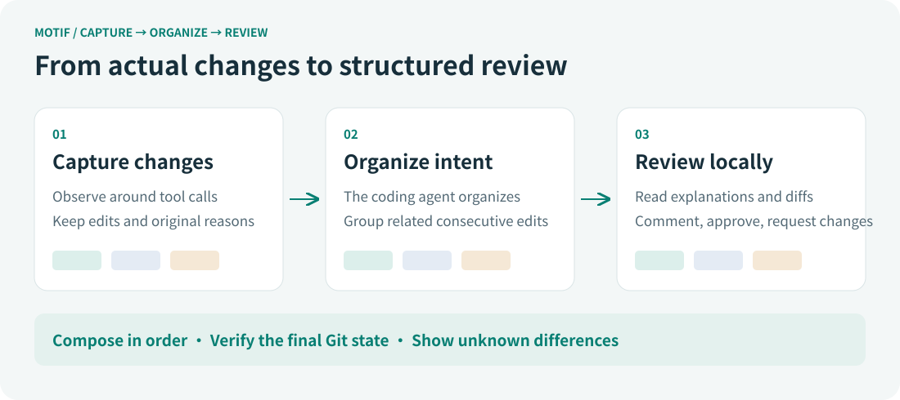
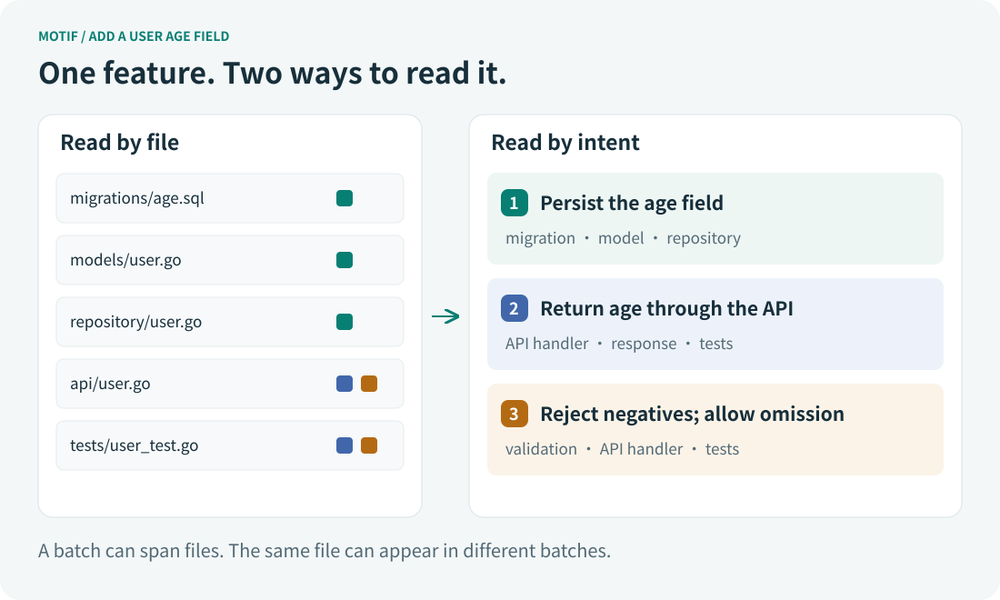

**[简体中文](README_CN.md)** | [English](README.md)

---


[](https://github.com/yhlooo/motif/releases/latest)
[](https://github.com/yhlooo/motif/actions/workflows/release.yaml)

# motif

**Understand AI code changes through the intent behind them.**

Motif is a local code review tool for Codex and Claude Code. It captures actual changes during development, then asks the agent writing the code to organize related edits into logical batches with explanations. In the Web UI, you can review both what changed and how those changes work together to accomplish a development intent.



## Why Motif

### Development has a structure that the final diff flattens

Suppose you want to add an age field to a user. You might first update a database migration, the user model, and persistence logic so the value can be stored. Then you change the response type and request handler to expose it through the API. Finally, you add validation and tests to establish that negative values are rejected and an omitted age is allowed.

That is a natural development sequence. Each step can span several files, and the same file can change again in a later step. The edits are related through the purpose they serve; their file paths tell you where they happen to live.

Open the final diff, however, and those steps become additions and deletions ordered by file. Edits serving one purpose are scattered across different locations. Edits made at different stages are folded into the same file diff. To judge whether the implementation is complete and consistent, you have to reconstruct the development structure in your head.

**Review requires understanding why lines change together, as well as understanding each individual line.**

### Faster code generation makes understanding changes more important

After you ask an agent to implement a feature, you may quickly receive changes across a dozen files and a summary saying the work is complete and tests pass. The summary gives you an overview, and tests provide validation results. Accepting the code still requires understanding the implementation: does the database field actually reach the API? Do validation rules agree with test assertions? Did an incidental refactor alter existing behavior?

These questions often cross file boundaries. With every change expanded at once, reviewers must keep several partially understood threads in mind. When you did not write the implementation yourself, checking the code can turn into deriving the whole solution again.

Motif aims to retain the structure already present during development. Alongside the code, the agent leaves a reviewable account of its changes, helping developers understand and assess the implementation they receive.

## Review one logical change at a time

Motif's central review unit is an **intent batch**: consecutive changes serving a shared purpose, accompanied by an explanation of why they belong to that step. A batch can span multiple files, and one file can appear in several batches.



In this example, you can start with “Persist the age field.” Its diff lets you focus on whether the migration, model, and persistence logic agree. Next, read “Return age through the API” and check the interface contract. Finally, inspect “Reject negative values, allow an omitted age” to assess boundary behavior and its tests.

The explanation gives you an entry point; the actual diff gives you evidence for a decision. You can build an understanding of the implementation through smaller questions, without having to understand every change before checking any part of it. When adjacent steps need to be considered together, select consecutive batches to inspect their combined effect.

Batches preserve change order. A line added and subsequently corrected can appear in two successive batches. Related changes made in different commits or turns are not arbitrarily joined just because they share a topic. Batches describe logical steps in the observed development sequence, while consecutive selection lets you adjust the scope of your reading during review.

## Why capture changes during development?

A final diff may support a summary such as “added age validation.” It rarely establishes why a particular condition was introduced, why an approach was abandoned, or whether several edits originally served the same purpose. A retrospective explanation can sound reasonable without being the actual reason for the change.

Motif therefore captures first and organizes later. Through hooks, it observes the workspace around tool calls, records actual file changes, and retains explanations the agent supplied at the time. What an Edit, Write, or shell command accomplished is grounded in the content changes it produced.

A tool call is not necessarily a useful review unit on its own. An agent may complete one logical step through several edits, and each original explanation may only describe its immediate operation. Before a development turn ends, Motif prompts that same coding agent to inspect the captured changes, group related consecutive records, and supply batch titles and explanations. The task and implementation context are still available, giving the organization a traceable basis.

This division gives capture responsibility for recording facts and the agent responsibility for presenting them coherently. You continue asking for changes and working with your agent. Motif adds an organization step before the turn ends, without requiring you to maintain a review document for every edit.

Original change records and organized explanations are stored separately. From a review batch, you can trace the original edits and check whether the explanation matches the code. Additional explanation helps you read, while leaving the original records available and the diff open to inspection.

## The steps must account for the final result

Batch review is useful only if the review covers the actual change. A few well-explained batches are insufficient if an unexplained block of code never appears among the items you inspect.

Motif composes review items in sequence and checks the result against the final Git state. This composes code state transitions: if a line changes from A to B and then from B to C, the final result must be A to C. Content added and later deleted must also be accounted for correctly. Concatenating patch text would not establish that relationship.

Unattributed differences appear explicitly as unknown changes and remain part of the review. Original changes that were not organized into a batch are shown as well. When records are missing or attribution cannot be reconstructed accurately, that uncertainty remains visible, so you can distinguish changes supported by captured history from changes needing additional investigation.

**Coverage of the final state and completeness of the development record are separate questions.** Hooks that did not run, interruptions, and unobserved operations can leave gaps in the process history. Final-state verification helps prevent omissions from the review scope; original records help explain where changes came from. Both provide evidence for the reviewer.

Approving individual batches still requires engineering judgment. Locally reasonable changes can interact incorrectly, and a clear explanation can accompany faulty code. Motif provides a more structured way to read and discuss changes. Review, tests, and developer judgment remain necessary to assess their quality.

## Fit it into your existing workflow

Motif integrates with an existing repository through project-level Agent and Git hooks. Capture data and review records are stored locally and presented through a local Web UI. You keep using your preferred agent to write code and Git to commit it. Review batches provide a reading structure within commits, without requiring a separate Git commit for every development step.

A CR (Code Review) covers committed changes from a source branch relative to a target branch, bringing together the captured changes and batches associated with commits in that range. In its detail view, you can read explanations and diffs, trace original edits, add line comments, and approve selected items or request changes. After further commits, refresh the CR to update the review range. Items retaining their identity retain their review records, while new items await review.

This is particularly useful when an agent has completed a task spanning multiple files and you need to understand how its parts fit together, or when an implementation is still evolving and you want to give feedback on a specific logical step. Motif turns reading one large diff into a sequence of contextual review steps, making cross-file inconsistencies easier to look for and feedback easier to place.

The project's goal is to make AI-generated code easier for people to understand and review. As agents take on more implementation work, developers still need an understanding of the implementation and the ability to make informed decisions about the result.

## Quick start

You need Git and a version of Codex or Claude Code that supports hooks.

### 1. Install

Supported platforms: macOS / Linux, amd64 / arm64.

```sh
curl -fsSL https://raw.githubusercontent.com/yhlooo/motif/main/scripts/install.sh | bash
```

The default installation directory is `~/.local/bin`. Make sure it is in your `PATH`.

### 2. Set up your project and develop

Install project-level Agent and Git hooks in an existing Git repository. Follow the prompts to select your agent:

```sh
cd your-project
motif install
git switch -c feat/user-age
```

Start Codex or Claude Code in the project and develop as usual. Motif records changes and prompts the agent to organize batches before the turn ends. Commit your work as usual when ready; CRs review committed branch changes. Use `motif doctor` to inspect hook configuration and activation.

### 3. Create and view a CR in the Web UI

Run from the project directory:

```sh
motif web
```

Open the address printed in the terminal (default: <http://127.0.0.1:3939>). Click “创建审查” (Create review), enter a title, select the source branch (e.g. `feat/user-age`) and target branch (e.g. `main`), then confirm the range to create a CR (Code Review).

In the detail view, read batch explanations and diffs, trace original changes, add line comments, and approve selected batches or request changes. After further commits, refresh the CR to review the new changes.
