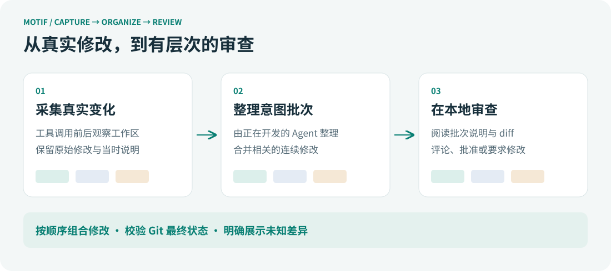
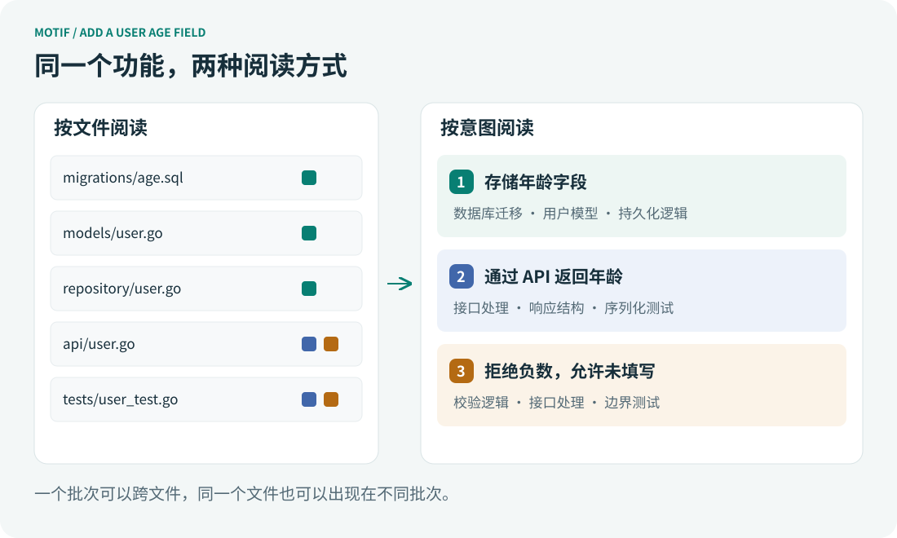

**[简体中文](README_CN.md)** | [English](README.md)

---


[](https://github.com/yhlooo/motif/releases/latest)
[](https://github.com/yhlooo/motif/actions/workflows/release.yaml)

# motif

**按开发意图，读懂 AI 的代码修改。**

Motif 是面向 Codex、Claude Code 的本地代码审查工具。它在开发过程中采集 Agent 的实际修改，再由正在编写代码的 Agent 将相关修改整理成带有原因说明的逻辑批次。你在 Web UI 中审查的，既有代码改了什么，也有这些修改如何一步步完成一个开发意图。



## 为什么需要 Motif

### 写代码有思路，最终 diff 却把它压平了

假设你要给用户增加一个年龄字段。你可能先修改数据库迁移、用户模型和持久化逻辑，确保这个字段能够存储；然后修改响应结构和接口处理，让 API 返回年龄；最后补上校验与测试，明确负数应该被拒绝、未填写应该被允许。

这是一条自然的开发思路。每一步都可能跨越多个文件，同一个文件也可能在不同步骤被再次修改。代码之间的关系由它们共同完成的事情决定，文件路径只是这些修改所在的位置。

但打开最终 diff，你往往只看到按文件排列的增删行。数据库、接口、模型、测试依次出现，完成同一件事的修改散落在不同位置，发生在不同阶段的修改又被放进同一份文件 diff。你需要在脑中重新拼出那条开发思路，才能判断实现是否完整、各处约定是否一致。

**审查的难点，不只有读懂每一行，还包括理解这些行为什么要一起改变。**

### AI 写得越快，理解修改就越重要

让 Agent 实现一个功能后，你可能很快得到十几个文件的修改，以及一段“已完成，测试通过”的总结。总结提供了方向，测试提供了验证结果，但要接纳这份代码，你仍然需要理解实现本身：数据库新增的字段是否真的传递到了接口？校验规则和测试断言是否一致？一个顺手的重构是否改变了原有行为？

这些问题经常跨越文件边界。如果所有修改一次性展开，审查者需要同时记住多个尚未理解完整的逻辑。尤其当你没有亲自经历编写过程时，阅读成本很容易从检查代码，变成重新推导整个实现。

Motif 希望把开发过程中已经存在的结构保留下来。让 Agent 生成代码，也让它留下能够被人审查的修改脉络，使开发者更容易理解并判断交到自己手中的实现。

## 按一件事审查，而不仅是逐个文件阅读

Motif 的核心审查单位是**意图批次**：一组连续发生、共同服务于某个目的的修改，以及解释它们为何属于同一步的说明。一个批次可以跨多个文件，同一个文件也可以出现在不同批次中。



在上面的例子中，你可以先审查“存储年龄字段”。只看这个批次的 diff，就能集中检查迁移、模型和持久化逻辑是否配套。接着阅读“通过 API 返回年龄”，再检查接口契约。最后阅读“拒绝负数，允许未填写”，确认边界行为和测试是否一致。

批次说明提供阅读入口，实际 diff 提供判断依据。你不必先理解全部修改，再回头验证每个局部；可以沿着一个个较小的问题，逐步建立对整体实现的理解。需要检查相邻步骤的配合时，也可以合并查看连续批次，观察它们共同产生的效果。

这里的批次保留修改顺序。同一行先增加、后修正，可以出现在前后两个批次中；相关修改如果在不同提交、不同回合发生，也不会仅仅因为主题相同就被任意拼接。批次表达的是实际开发过程中的逻辑步骤，连续选择则让你在审查时调整阅读范围。

## 为什么要在开发过程中采集

仅凭最终 diff，可以概括“新增了年龄校验”，却很难知道一个条件为什么被增加、一次尝试为什么被放弃，以及某几处修改最初是不是为了同一个目的。事后生成的解释可能合理，但合理的解释并不自动等于真实的开发原因。

Motif 因此采用“先采集，再整理”的方式。它通过 hooks 在工具调用前后观察工作区，记录实际发生的文件变化，并保留 Agent 当时提供的说明。Edit、Write 或 shell 命令产生了什么结果，以实际内容变化为依据。

一次工具调用也未必刚好对应一个适合阅读的批次。Agent 可能分几次编辑完成同一件事，原始说明也可能只够解释当前操作。因此，在一轮开发结束前，Motif 提示同一个 coding Agent 查看已采集的修改，合并相关的连续记录，并补充批次标题与原因。此时任务和实现上下文仍在，整理有可追溯的依据。

这种分工让采集负责记录事实，让 Agent 负责组织表达。你照常提出需求、让 Agent 开发；Motif 在回合结束前加入整理环节，无需为每次编辑手工维护一套审查文档。

原始修改记录与整理后的说明分别保存。需要时，你可以从审查批次追溯原始修改，核对解释和代码是否对应。补充说明能够帮助阅读，但不会覆盖当时的记录，也不会代替 diff 本身。

## 每一步能读懂，也要对得上最终结果

分批审查只有在覆盖完整变更时才有意义。如果界面展示了几个解释清楚的批次，却漏掉一段未经说明的代码，读完这些批次也不足以理解实际交付的结果。

Motif 将审查项按顺序组合，并与 Git 中的最终状态校验。这里组合的是代码状态变化：同一行从 A 改成 B，又从 B 改成 C，最终应当得到 A 到 C 的结果；新增后又删除的内容，也不能被当作两份独立的最终修改简单相加。

无法归属的差异会明确列为未知修改，仍然进入审查范围。没有整理成批次的原始修改也会展示出来。遇到缺失的记录或无法准确还原的归属，界面保留这种不确定性，让你看到哪些内容有过程依据，哪些需要额外检查。

**最终状态得到覆盖，与开发过程被完整记录，是两件需要分别判断的事。** hooks 未运行、中断或未被观察到的操作，都可能留下过程缺口。最终校验帮助避免审查范围遗漏，原始记录帮助理解变化来源；两者共同为审查提供依据。

逐批批准也仍然需要工程判断。局部实现看起来合理，组合起来可能存在交互问题；说明清楚，代码也可能有错。Motif 提供一种更有层次的阅读与反馈方式，代码质量仍要由审查、测试和开发者判断共同保证。

## 融入已有的开发与审查流程

Motif 通过项目级 Agent 和 Git hooks 接入现有仓库，采集数据和审阅记录保存在本机，并通过本地 Web UI 展示。你继续使用熟悉的 Agent 编写代码、使用 Git 提交；审查批次提供比提交更细的阅读层次，无需把每一步操作都做成一个 Git commit。

一个 CR（Code Review）针对源分支相对目标分支的已提交变更创建，汇集范围内提交对应的修改记录和批次。在详情页，你可以阅读说明与 diff、追溯原始修改、添加行评论，并批准所选内容或要求修改。继续提交后，刷新 CR 更新审查范围；仍保留原身份的审查项保留相应记录，新项等待审查。

这尤其适合这样的时刻：Agent 已经完成一项跨文件任务，你需要理解各处实现如何配合；或者代码仍在迭代，你希望围绕一段明确的逻辑提出反馈。Motif 把“看完一大份 diff”转化为一系列有上下文的审查步骤，让你更容易发现跨文件的不一致，也更容易说明哪里需要修改。

项目的目标是让 AI 生成的代码更容易被人理解和审查。Agent 可以承担更多编写工作，开发者则需要保有对实现的理解，以及对最终结果作出决定的能力。

## 快速开始

需要 Git，以及支持 hooks 的 Codex 或 Claude Code。

### 1. 安装

支持 macOS / Linux，amd64 / arm64：

```sh
curl -fsSL https://raw.githubusercontent.com/yhlooo/motif/main/scripts/install.sh | bash
```

默认安装到 `~/.local/bin`，请确保该目录在 `PATH` 中。

### 2. 初始化项目，正常开发

在已有 Git 仓库中安装项目级 Agent 和 Git hooks，按提示选择使用的 Agent：

```sh
cd your-project
motif install
git switch -c feat/user-age
```

在该项目中启动 Codex 或 Claude Code，照常开发。Motif 会记录修改，并在回合结束前提示 Agent 整理批次。完成后照常提交代码；CR 审查的是已提交的分支变更。可用 `motif doctor` 检查 hooks 配置与生效情况。

### 3. 在 Web UI 创建和查看 CR

在项目目录运行：

```sh
motif web
```

打开终端显示的地址（默认 <http://127.0.0.1:3939>），点击「创建审查」，填写标题，选择源分支（如 `feat/user-age`）和目标分支（如 `main`），确认范围后创建 CR（Code Review）。

在详情页按批次查看说明与 diff，追溯原始修改，添加行评论，并选择「批准所选」或「要求修改」。后续提交后刷新 CR，继续审查新增内容。
